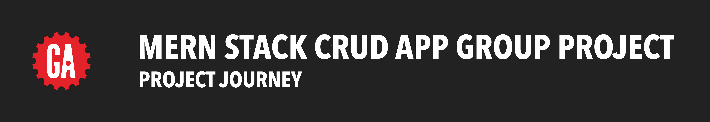

# 

## About

**_Instructors should see the Instructor Guide for more configuration details._**

In this project, students will build an authenticated Node/Express/MongoDB application with full CRUD.

## Prerequisites

This project requires an understanding of full-stack authenticated applications built using Express, Node, MongoDB, and EJS.

## Content

[Project Journey](./project-journey/README.md)

[Project Requirements](./project-requirements/README.md)

[Project Details](./project-details/README.md)

[Project Deliverables](./project-deliverables/README.md)

[Project Requirements PDF](./project-requirements/assets/project-requirements.pdf)
