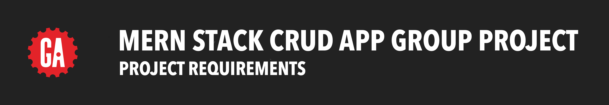

# 

## Overview

For this project, you'll work across the back-end and the front-end to build a full-stack project with a team.

Your team will build an API on the back-end using Express and Node secured with JWTs. That API will interact with MongoDB to carry out full CRUD on resources.

On the front-end, your team will construct a React application that uses AJAX to communicate with the back-end app.

**_You will work in a group on this project_**.

> ❗️ As a reminder, General Assembly has a zero-plagiarism policy. **_Your project's code must be substantially your group's_**. Do not copy code from similar projects or other sources. However, using code from the internet to accomplish generic tasks is okay - for example, a line of code that replaces a character at a specific position in a string.

  
## Requirements

### **Technical Requirements - MVP**
If more than two items are marked "no" in this section, this section will be considered a failure. If two or fewer items are marked "no", it is considered passed. Your app must fulfil the requirements listed below.

|   |   |
|---|---|
|1.1|The back-end application is built with Express and Node.|
|1.2|The front-end application is built with React.|
|1.3|MongoDB is used as the database management system.|
|1.4|The back-end and front-end applications implement JWT token-based authentication to sign up, sign in, and sign out users.|
|1.5|Authorization is implemented across the front-end and back-end. Guest users (those not signed in) should not be able to create, update, or delete data in the application or access functionality allowing those actions.|
|1.6|The project has at least two data entities in addition to the User model. At least one entity must have a relationship with the User model.|
|1.7|The project has full CRUD functionality on both the back-end and front-end.|
|1.8|The front-end application does not hold any secret keys. Public APIs that require secret keys must be accessed from the back-end application.|
|1.9|(Optional) The project is deployed online so that the rest of the world can use it.|

### **Code Convention Requirements**
If more than two items are marked "no" in this section, this section will be considered a failure. If two or fewer items are marked "no", it is considered passed. Your app must fulfil the requirements listed below.

|   |   |
|---|---|
|2.1|The files in the back-end and front-end applications are organized following the conventions demonstrated in lectures.|
|2.2|The code in the back-end and front-end applications adheres to the coding conventions demonstrated in lectures, like using plural names for arrays.|
|2.3|The back-end and front-end applications do not contain dead code, commented-out sections, or console logs.|
|2.4|The back-end application can be used without encountering errors in the terminal. The front-end application can be used without encountering errors in the browser's console.|
|2.5|The back-end application follows RESTful routing conventions for routes.|
|2.6|The back-end and front-end applications are coded using proper indentation.|

### **Code Understanding Requirements**
If any item is marked "no" in this section, this section will be considered a failure. The presenter must fulfil the requirements listed below.

|     |                                                                                                                                                    |
| --- | -------------------------------------------------------------------------------------------------------------------------------------------------- |
| 2.7 | Explain (correctly) their codes when asked questions during the soft launch/check-in, pre and post presentation.                                   |
| 2.8 | Explain the conceptual understanding of their codes, e.g. why they used a certain package, why they wrote the codes a certain way and not another. |

### **UI/UX Requirements**
If more than two items are marked "no" in this section, this section will be considered a failure. If two or fewer items are marked "no", it is considered passed. Your app must fulfill the requirements listed below.

|   |   |
|---|---|
|3.1|The application exhibits a visual theme, like a consistent color palette and cohesive layout across pages.|
|3.2|The application is easily navigable by a first-time user. For example, navigation should be done through links instead of having to type in a URL to navigate around the app.|
|3.3|The application utilizes CSS Flexbox and/or Grid and/or a CSS framework for page layout design.|
|3.4|Colors used in the app have appropriate contrast that meet the WCAG 2.0 level AA standard.|
|3.5|When editing an item, the form is pre-filled with that item's details.|
|3.6|Only the user who created a piece of data can see and interact with the UI for editing or deleting that data.|
|3.7|All images have alt text.|
|3.8|No text is placed on top of an image in a way that makes the text inaccessible.|
|3.9|All buttons are styled.|

### **Git and GitHub Requirements**
If any item is marked "no" in this section, this section will be considered a failure. Your interactions with Git and GitHub must fulfil the below requirements.

|   |   |
|---|---|
|4.1|You and your team are shown as the only contributors to the project on GitHub.|
|4.2|The GitHub repositories used for the project must be named appropriately. For example, names like book-binder-back-end or wellness-tracker-front-end are appropriate, whereas ga-project or mern-stack-project are not. The repos must be publicly accessible. Be sure to create the repos on your personal GitHub account and ensure they are public.|
|4.3|Your repos should have commits that date back to the very beginning of the project. If you start over with a new repo, do not delete the old one.|
|4.4|Commit messages should be descriptive of the work done in that commit.|

### **README Requirements**
If more than two items are marked "no" in this section, this section will be considered a failure. If two or fewer items are marked "no", it is considered passed. Your README must contain the items or sections below.

|     |                                                                                                                                                                                                                                                                   |
| --- | ----------------------------------------------------------------------------------------------------------------------------------------------------------------------------------------------------------------------------------------------------------------- |
| 5.1 | Screenshot/Logo: A screenshot of your app or a logo.                                                                                                                                                                                                              |
| 5.2 | Your app's name: Include a description of your app and its functionality. Background info about the app and why you built it is a nice touch.                                                                                                                     |
| 5.3 | Getting started: This section should include a link to your deployed app, a link to your planning materials, and a link to the back-end repository.                                                                                                               |
| 5.4 | Attributions: This section should include links to any external resources (such as libraries or assets) or AI/LLM questions you used to develop your application that require attribution. You can exclude this section if it does not apply to your application. |
| 5.5 | Technologies used: List the principal technologies used by your application, for example: JavaScript and any major frameworks or libraries.                                                                                                                       |
| 5.6 | Next steps: Planned future enhancements (stretch goals).                                                                                                                                                                                                          |
| 5.7 | The back-end README file contains the name of the project and a link pointing to the front-end repository on GitHub for more details on the project.                                                                                                              |

### **Presentation Requirements**
If any item is marked "no" in this section, this section will be considered a failure. Your presentation must fulfil the below requirements.

|   |   |
|---|---|
|6.1|Your group (everyone) presents your project in front of the class on the scheduled presentation day.|
|6.2|The project your group presents is the project you were approved by your instructor to build.|

## Evaluation

Upon completion of your presentation, your instructional team will evaluate your project.

- Your instructors will be using the above guidelines to determine whether or not the project passes all of the minimum requirements.
- If your instructors determine that the project does not meet the minimum requirements, your group would have failed the unit and hence the course. Please reach out to your student success specialist if you have questions.
- Within a week after your presentation, your instructors will provide you with feedback on your project.
- If there is a specific section of code that you would like an instructor to provide additional feedback on, please ask!